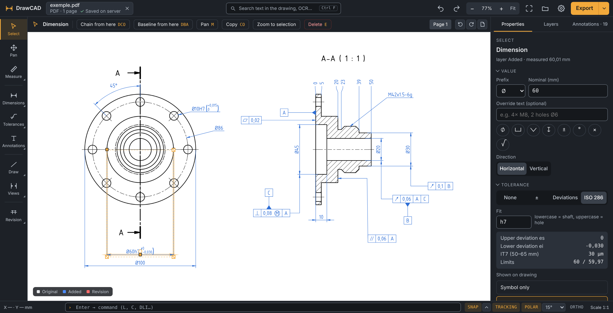

<div align="center">


# DrawCAD

**Dimension, tolerance and revise technical drawings, right on the PDF.**
Self-hosted, runs in your browser, no CAD license needed.

[](LICENSE)
[](https://github.com/movidiu64/DrawCAD/actions/workflows/ci.yml)
[](https://github.com/movidiu64/DrawCAD/pkgs/container/drawcad)
[](https://github.com/movidiu64/DrawCAD/releases)
[](https://github.com/movidiu64/DrawCAD/releases)




</div>

Open a PDF exported from CAD, or a scan or photo of a drawing, add dimensions, tolerances, GD&T and revisions with AutoCAD-style snapping, then export a clean vector PDF or a DXF. The original file is never modified: annotations are stored separately and applied only on export.

## Features

- 📏 **Dimensions**: linear (also chain and baseline series, and rotated at any angle), aligned, diameter, radius, angle, ordinate (from a base point) with a hole table (X, Y, Ø), chamfer, leaders and text, with AutoCAD-like object snaps (endpoint, midpoint, center, intersection, apparent intersection, extension, tracking, polar, perpendicular, tangent).
- 🎯 **Tolerances**: ±, deviations, ISO 286 fits with automatic limits (`Ø25k6 (+0.015/+0.002)`), and the ISO 2768-1 general tolerance of every dimension without one (class f, m, c or v), written on it with one click.
- ⌖ **GD&T** (ISO 1101): all 14 characteristics, modifiers, datums. **Surface roughness** (ISO 1302 / 21920-1).
- 🔺 **Revisions**: strike-through value, new value and revision triangle, an auto-filled revision table, revision clouds, and the revision number in the file name (`_rev2`) and the PDF metadata, raised automatically on the first change after an export.
- 🔀 **Revision compare**: lay an older revision over the page: red = removed, green = added, step through the changes and save the comparison as a PDF; an export at another scale or rotated lines up with two reference points.
- 🖍️ **Review markup**: highlighter, comments exported as PDF notes, stamps (APPROVED, CHECKED…, with date and name) and a watermark.
- 🗂️ **Title blocks, images and QR codes**: an ISO 7200 title block generator and your own templates (kept in the browser) with fields filled from the document, logos and pictures (also pasted with Ctrl+V), and a QR code with the drawing number and revision.
- 🧾 **Drawing tools**: notes, parts list, section and detail views, balloons, lines, arcs, hatches, break lines, with ISO 128 line types.
- 🧽 **Edit the original**: white-out or truly remove PDF objects, turn faint colored drawings black for printing, rotate, reorder and resize pages (with undo).
- 🔎 **Search and OCR**: Ctrl+F finds any text; scans are recognized with Tesseract (English and Romanian included) and can be exported as searchable PDFs.
- 📐 **DXF export** for AutoCAD / Allplan: real lines, arcs, circles and texts, at paper size or true scale. Scans can be vectorized (experimental).
- ⌨️ **AutoCAD habits**: command line (`L`, `C`, `PL`, `DLI`…) with prompts and options, typed points (`x,y`, `@dx,dy`, `@d<a`) from a page origin or a UCS, snap overrides (`END`, `CEN`…) and Tab cycling, MOVE / COPY / ERASE, hot grips (Space: stretch, move, rotate at any angle, scale, mirror), `acad.pgp` import, command history (F2), typed length and angle while drawing, area and perimeter (`DI` → `A`). **Ctrl+K** finds any command by name, **?** lists every key.
- 🌗 **Dark or light** interface (or as the system), in English or Romanian.
- 🔒 **Self-hosted and private**: hardened container (read-only, no extra privileges), active content removed from uploaded PDFs, optional password, per-browser workspaces.

## Quick start

### Docker Compose

```yaml
services:
  drawcad:
    image: ghcr.io/movidiu64/drawcad:latest
    container_name: drawcad
    restart: unless-stopped
    ports:
      - "8478:8080"
    volumes:
      - ./data:/data
    environment:
      PUID: 1000
      PGID: 1000
```

```bash
docker compose up -d
```

Open `http://<server-ip>:8478`. The full [`compose.yaml`](compose.yaml) adds hardening (read-only filesystem, dropped capabilities), a health check and all options. Copy [`.env.example`](.env.example) to `.env` to adjust it.

### Docker run

```bash
docker run -d --name drawcad -p 8478:8080 -v drawcad-data:/data ghcr.io/movidiu64/drawcad:latest
```

### Unraid

Install it from the template: on the **Docker** tab, under **Template repositories**, add

```
https://github.com/movidiu64/DrawCAD
```

then **Add Container** and choose **DrawCAD**. The template ([`unraid/drawcad.xml`](unraid/drawcad.xml)) keeps the data in `/mnt/user/appdata/drawcad`, runs as `99:100` with the same hardening as `compose.yaml`, and adds a WebUI button. The [`compose.yaml`](compose.yaml) stack works too (Compose Manager or Dockhand).

### Windows desktop app

Download `DrawCAD-<version>-setup.exe` from [Releases](https://github.com/movidiu64/DrawCAD/releases). It needs no admin rights, no Docker and no internet connection, and OCR is included. A portable `.zip` is also available.

> [!NOTE]
> The installer is not code-signed, so Windows SmartScreen may show "Windows protected your PC". Click **More info → Run anyway**. The files are built by GitHub Actions from this repository; the run that built each release is linked from the Actions tab.

## Configuration

| Variable | Default | Description |
|---|---|---|
| `DRAWCAD_MODE` | `private` | `private`: each browser has its own documents. `personal`: single user, documents visible from any browser. `session`: like private, but only until the browser closes. |
| `DRAWCAD_PASSWORD` | *(empty)* | HTTP Basic password (user `drawcad`). Leave empty on a trusted LAN. |
| `DRAWCAD_RETENTION_DAYS` | `30` | Unused documents are deleted after this many days (`0` = never). |
| `DRAWCAD_MAX_UPLOAD_MB` | `200` | Maximum upload size. |
| `DRAWCAD_OCR_LANG` | `ron+eng` | Tesseract languages. |
| `DRAWCAD_CACHE_MB` | `256` | RAM cache limit (only used as needed). |
| `PUID` / `PGID` | `99` / `100` | User the app runs as. The data folder is chowned automatically. |

All variables are listed in the [full guide](docs/guide.md#environment-variables).

> [!IMPORTANT]
> DrawCAD has no user accounts. Keep it on your local network, or put it behind a reverse proxy with HTTPS and authentication. At minimum, set `DRAWCAD_PASSWORD`.

## Documentation

The complete guide is in [`docs/guide.md`](docs/guide.md). It covers every tool, the snap modes, keyboard shortcuts and commands, OCR, DXF export, the desktop app and known limitations. The app interface itself is available in English and Romanian.

## Development

No build step: the frontend is plain ES modules served by a Starlette backend.

```bash
cd backend && pip install -r requirements.txt
DRAWCAD_DATA=./data DRAWCAD_MODE=personal uvicorn app.main:app --port 8080
cd backend && python -m unittest discover -s tests      # API tests
cd frontend && npm test                                 # ISO 286 tables, geometry
python tools/e2e_smoke.py http://127.0.0.1:8080 out     # end-to-end in Chromium (Playwright)
```

Built with [PDFium](https://pdfium.googlesource.com/pdfium/) (pypdfium2), [pikepdf](https://github.com/pikepdf/pikepdf), [ReportLab](https://www.reportlab.com/), [ezdxf](https://github.com/mozman/ezdxf), [Tesseract](https://github.com/tesseract-ocr/tesseract) and the [osifont](https://github.com/hikikomori82/osifont) ISO 3098 font. Third-party licenses are listed in the [guide](docs/guide.md#architecture).

## License

DrawCAD is free software under the [GNU Affero General Public License v3.0](LICENSE). You can use, modify and self-host it freely. If you distribute it, or offer a modified version as a network service, you must share your source code under the same license.

© 2026 Ovidiu ([movidiu64](https://github.com/movidiu64))
